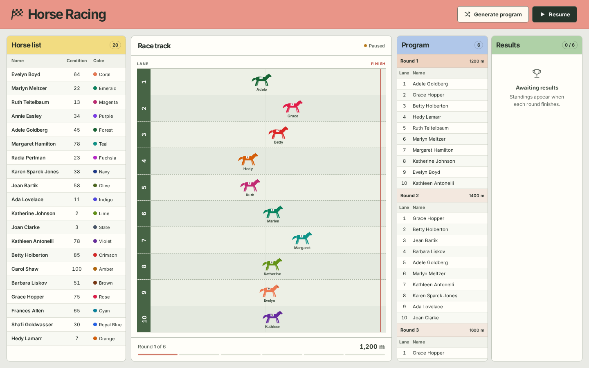

# Horse Racing

Draw a field of ten horses, start the race, and watch the finishing order appear as each round ends. This Vue 3, Pinia and Vite application was built for the Insider One Front-end Developer case study.



## Try the offline demo

Download the repository using **Code → Download ZIP**, extract it, and open the top-level `index.html` in a browser. Select **Generate program**, then **Start**. You can pause and resume at any point.

## How the race works

Each of the six rounds draws ten horses from a pool of twenty. Distances increase from 1,200 m to 2,200 m in 200 m steps. Each horse’s condition and pace determine its simulated crossing time. Once the last horse crosses, the Results panel publishes all ten placings.

## Run from source

With Node.js 22.12 or later and npm installed, run these commands from the repository root:

```bash
cd horse-racing
npm ci
npm run dev
```

## Tests

From `horse-racing/`, run `npm run test:unit` to check the race calculations and state transitions. The browser suite covers the full six-round flow, pause and resume, offline loading, and desktop and mobile screenshot comparisons.

See the [project guide](horse-racing/README.md) for browser installation, test commands and the source layout.
